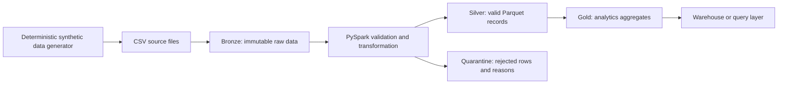

# Enterprise Cloud Data Integration Platform

A portfolio project demonstrating a scalable batch data pipeline: generate synthetic order data, ingest it, validate records, transform trusted data, and produce analytics-ready outputs.

All included records are synthetic and created for this demonstration. The repository is a local learning implementation; it does not contain employer, customer, or personal data, and it does not claim that a cloud deployment has been completed.

## Scale is part of the design

The tiny CSV in `data/source/` is only a learning fixture for our first notebook. It is not the benchmark dataset. The deterministic, configurable generator writes large files in chunks instead of holding millions of rows in memory. The pipeline will use PySpark so we can demonstrate distributed-data patterns in local mode.

The 10-thousand-row and 1-million-row profiles have completed locally. Their measured runtime, throughput, input/output sizes, quality counts, and setup are recorded in the [benchmark report](docs/scale_and_benchmarking.md). A 5-million-row profile remains optional and depends on available laptop memory and disk. These are local synthetic-data measurements, not cloud or production benchmarks.

## What we are building

1. Define and document a data contract for order events.
2. Generate synthetic source data at configurable scale with a fixed random seed for repeatable runs.
3. Ingest inputs into an immutable raw (bronze) layer.
4. Use PySpark to validate records, quarantine rejected rows with reasons, and write clean (silver) Parquet.
5. Create analytics-ready (gold) aggregates.
6. Add data quality checks, repeatable orchestration, and benchmark reporting.
7. Run supporting services locally with Docker, then document how the design maps to AWS services.

## Architecture



See [architecture notes](docs/architecture.md), the [data contract](docs/data_contract.md), and the [scale and benchmarking plan](docs/scale_and_benchmarking.md).

## Current learning step

Open `notebooks/01_explore_source_data.ipynb` to profile the 20-row sample. Then use `python scripts/generate_orders.py --rows 10000 --rows-per-file 2000 --output-dir data/source/generated_10000` to create a reproducible practice batch. The generator streams rows into bounded-size CSV files. See the [benchmark report](docs/scale_and_benchmarking.md) for completed 10-thousand and 1-million-row runs.

## Planned tools

- Python and Jupyter Notebook for guided exploration and the deterministic generator.
- PySpark for distributed-style batch transformations and Parquet output.
- Docker Desktop for isolated local services.
- A local S3-compatible object store for practicing object-storage patterns.
- Airflow for orchestration, added as an optional profile after the core pipeline works.
- Later cloud mapping: Amazon S3, AWS Glue/Spark, and Redshift concepts. A local substitute is not an AWS deployment.

## Resource-aware runs

The pipeline uses a small profile for learning and has completed a 1-million-row local run. The optional 5-million-row run should only be attempted after checking available disk and memory. Start one heavy Docker service at a time on this laptop.

## GitHub readiness checklist

Before publishing, we will include setup instructions, architecture and data-contract documentation, reproducible commands, an honest benchmark report, and screenshots or diagrams that explain the result. Do not commit generated large datasets, access keys, employer data, or unmeasured performance claims.


## Process the generated data with PySpark in Docker

After generating `data/source/generated_10000`, start only the Spark service:

```text
docker compose -f compose.spark.yml run --rm spark
```

The compose file uses the Apache Spark Docker image, runs in local mode with two worker threads, and caps the container at 2.5 GB of memory. Spark is isolated in Docker so the Anaconda environment does not need a separate Java installation. The pipeline copies the source files into bronze, validates them, writes accepted records to silver Parquet, writes rejected records and reasons to quarantine Parquet, and creates daily gold aggregates.

The command above is the first learning run. To process the million-row profile, first generate it into `data/source/generated_1000000`, then in Anaconda Prompt run `set ORDERS_INPUT_DIR=data/source/generated_1000000` before the same Compose command. Review the measured time, row counts, and actual resource use before moving to the larger profile.

To read a small sample from the million-row run's gold Parquet output, run this from the project folder:

```text
docker compose -f compose.spark.yml run --rm --entrypoint /opt/spark/bin/spark-submit spark --master local[2] --driver-memory 1g scripts/inspect_gold.py --path data/gold/run_20261010T112012_732243Z
```

This checks that the gold order-line, unit, and sales totals match silver, then prints the output schema and ten daily aggregates. It reads the Parquet files with Spark inside Docker; there is no need to open the files directly in File Explorer or install PySpark into Anaconda.

The image tag is pinned so a later image update does not silently change benchmark results. The Apache Spark image includes PySpark; Spark's `DataFrameReader` supports explicit schemas, and its Parquet writer supports partitioned output. See [Apache Spark's official Docker image](https://hub.docker.com/_/spark), [CSV and schema documentation](https://spark.apache.org/docs/latest/sql-data-sources-csv.html), and [partitioned Parquet writer API](https://spark.apache.org/docs/latest/api/python/reference/pyspark.sql/api/pyspark.sql.DataFrameWriter.partitionBy.html).

